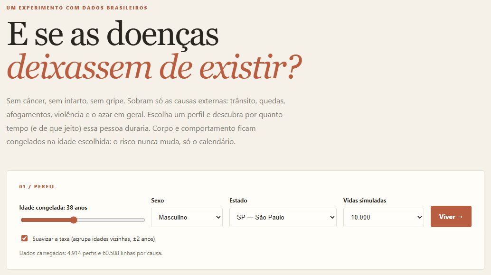
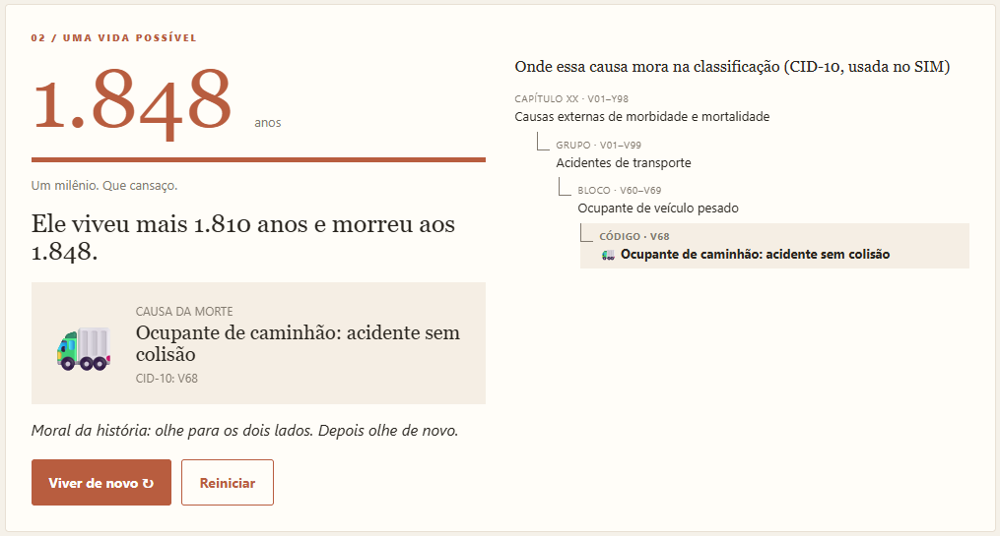
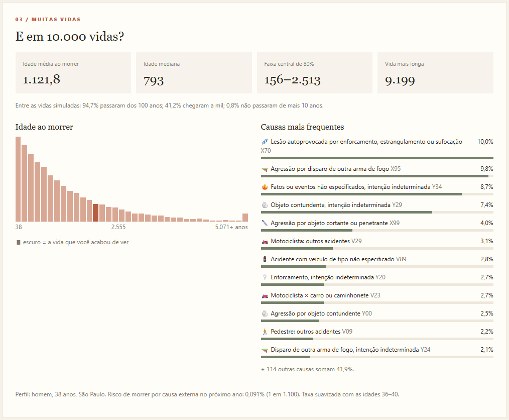

# Vida Longa

**Quão longas seriam nossas vidas em um mundo sem doenças?**

E se o transumanismo vingar (ainda mais do que já vingou) e encontrássemos a cura de todas as doenças e mesmo do envelhecimento? Sem as causas internas de morte, só sobrariam as externas: trânsito, quedas, afogamentos, violência e azar. A expectativa de vida poderia aumentar de menos de um século hoje para séculos ou milênios. O Vida Longa cria vidas possíveis a partir de causas externas de morte, "congelando" o perfil escolhido na idade selecionada.

Mas faz sentido esse tipo de extrapolação ou experimento? Talvez não muito, pois o fim das doenças e do envelhecimento provavelmente acarretaria uma mudança na condição humana tão grande que extrapolar da condição anterior não fosse realista. Mas ainda assim é algo divertido de fazer e pode dar uma ideia de todo o potencial que haveria nessa empreitada.

Esse projeto foi inspirado em [PolStats — Life](https://polstats.com/#!/life), que faz algo semelhante com dados americanos. Aqui, porém, o experimento usa dados brasileiros: SIM/DATASUS para óbitos por causas externas e estimativas populacionais do IBGE.

## Ver o experimento

Sirva o projeto localmente:

```bash
python -m http.server 8000
```

Depois abra `http://localhost:8000`.

## Como funciona

Escolha idade, sexo e estado, execute entre 1.000 e 100.000 vidas simuladas e veja:

- uma vida sorteada;
- a causa de morte e sua posição na classificação CID-10;
- a distribuição das idades ao morrer;
- as causas externas mais em enos frequentes para o perfil.

O modelo usa uma taxa anual calculada a partir do [SIM](https://dadosabertos.saude.gov.br/dataset/sim), aplica o risco de forma exponencial e escolhe uma causa proporcional ao número de óbitos observados. Quando o perfil fica congelado na idade escolhida, o risco não envelhece junto.

## Capturas de tela

### Perfil



### Uma vida possível



### Muitas vidas



## Estrutura do repositório

```text
vida-longa/
├── index.html
├── README.md
├── LICENSE
├── assets/
│   ├── selection.png
│   ├── results_person.png
│   └── results_people.png
├── data/
│   ├── Mortalidade_Geral_2024.csv
│   ├── projecoes_2024_tab1_idade_simples.xlsx
│   ├── Dicionario_SIM_2025.pdf
│   └── processed_data/
│       ├── mortality_total.csv
│       └── mortality_by_cause.csv
└── scripts/
    └── process_mortality.py
```

## Dados

- [Sistema de Informações sobre Mortalidade — SIM](https://dadosabertos.saude.gov.br/dataset/sim)
- [Dicionário de Dados do SIM 2025](https://s3.sa-east-1.amazonaws.com/ckan.saude.gov.br/SIM/Dicionario_SIM_2025.pdf)
- [Base da Mortalidade Geral 2024](https://dadosabertos.saude.gov.br/dataset/sim/resource/f0bdf83f-708e-4de9-9582-959055844ae9)
- [População estimada — IBGE](https://www.ibge.gov.br/estatisticas/sociais/populacao/9109-populacao-estimada.html)

Os dados originais ficam em `data/`; os CSVs usados pela página são gerados em `data/processed_data/`.
