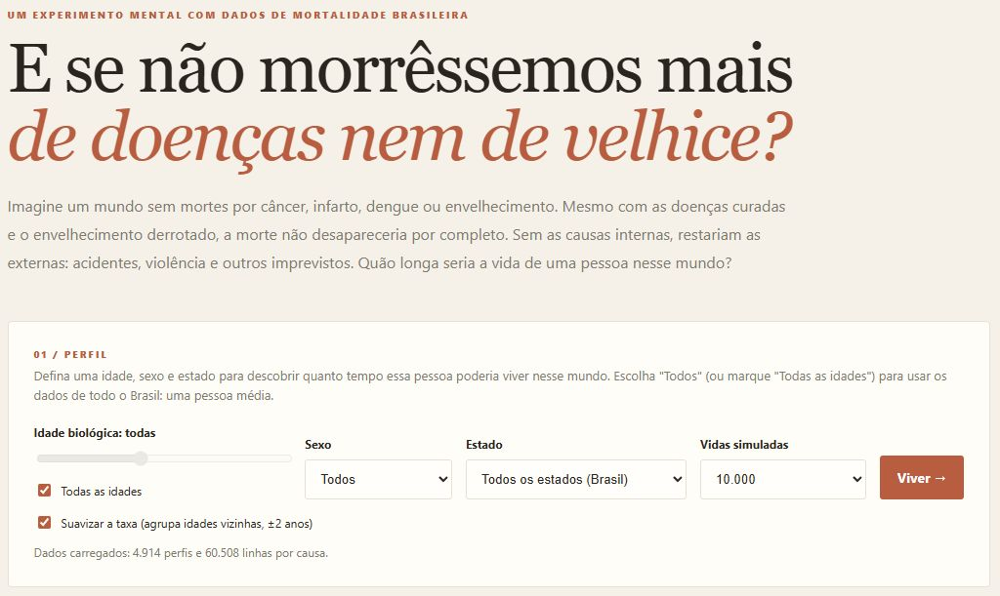
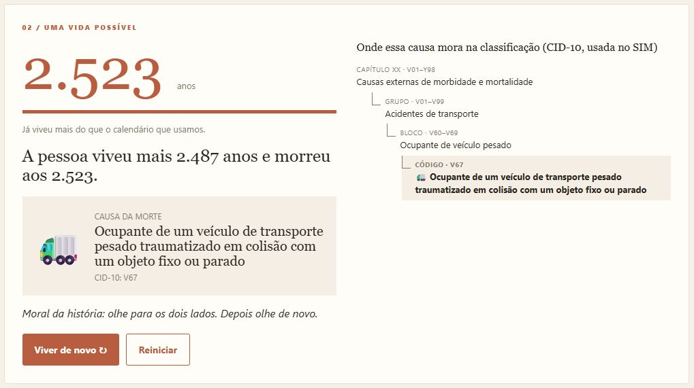
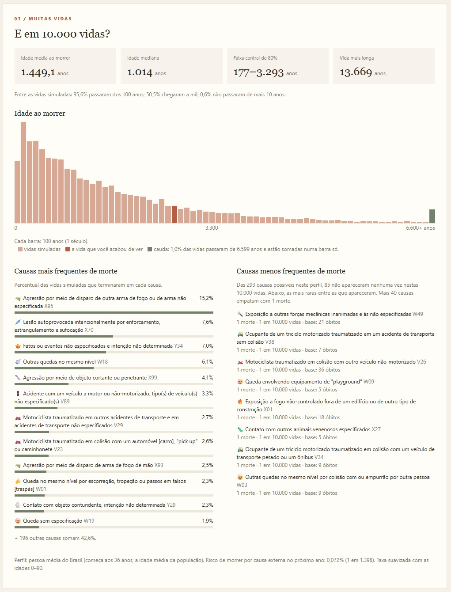

# Vida Longa

**How long would our lives be in a world without diseases or aging?**

What if transhumanism won (even more than it already has) and we found cures for every disease and for aging itself? Without internal causes of death, only external ones would remain: falls, drownings, violence, and chance. Life expectancy could increase from less than a century today to centuries or even millennia. Vida Longa generates possible lifespans for a chosen biological age and selected profile based on external causes of death. It is like to take a snapshot of mortality in Brazil in 2024 and ask what happens if that snapshot becomes a permanent property of humanity.

Does this kind of extrapolation or experiment make sense? Perhaps not very much, since the end of disease and aging would probably bring about a change in human conditions so profound that extrapolating from the previous condition would not be realistic. But it is still a fun experiment and can provide a sense of the potential that could be involved in such an endeavor.

This project was inspired by [PolStats — Life](https://polstats.com/#!/life), which does something similar with American data. Here, however, the experiment uses Brazilian data: SIM/DATASUS for deaths caused by external factors and population estimates from IBGE.

For the moment, the page is only available in Portuguese.

## View the experiment

Serve the project locally:

```bash
python -m http.server 8000
```

Then open `http://localhost:8000`.

## How it works

Choose an age, sex, and state, run between 1,000 and 100,000 simulated lives, and view:

- one randomly generated life;
- the cause of death and its position in the ICD-10 classification;
- the distribution of ages at death;
- the most and least frequent external causes of death for the profile.

The model uses an annual mortality rate calculated for the selected profile from [SIM](https://dadosabertos.saude.gov.br/dataset/sim), applies the risk exponentially, and chooses a cause in proportion to the number of deaths observed in SIM. When the profile is frozen at the selected biological age, the risk does not age with it.

## Repository structure

```text
vida-longa/
├── index.html
├── README.md
├── LICENSE
├── .gitignore
├── assets/
│   ├── favicon.ico
│   ├── selection.png
│   ├── results_person.png
│   └── results_people.png
├── data/
│   ├── Mortalidade_Geral_2024.csv
│   ├── projecoes_2024_tab1_idade_simples.xlsx
│   ├── Dicionario_SIM_2025.pdf
│   └── processed_data/
│       ├── cid10_causas_externas.csv
│       ├── mortality_total.csv
│       └── mortality_by_cause.csv
└── scripts/
    └── process_mortality.py
```

## Screenshots

### Profile



### One possible life



### Many lives



## Data

- [Mortality Information System — SIM](https://dadosabertos.saude.gov.br/dataset/sim)
- [SIM 2025 Data Dictionary](https://s3.sa-east-1.amazonaws.com/ckan.saude.gov.br/SIM/Dicionario_SIM_2025.pdf)
- [2024 General Mortality Database](https://dadosabertos.saude.gov.br/dataset/sim/resource/f0bdf83f-708e-4de9-9582-959055844ae9)
- [Estimated population — IBGE](https://www.ibge.gov.br/estatisticas/sociais/populacao/9109-populacao-estimada.html)

The original data is stored in `data/`; the CSV files used by the page are generated in `data/processed_data/`.
